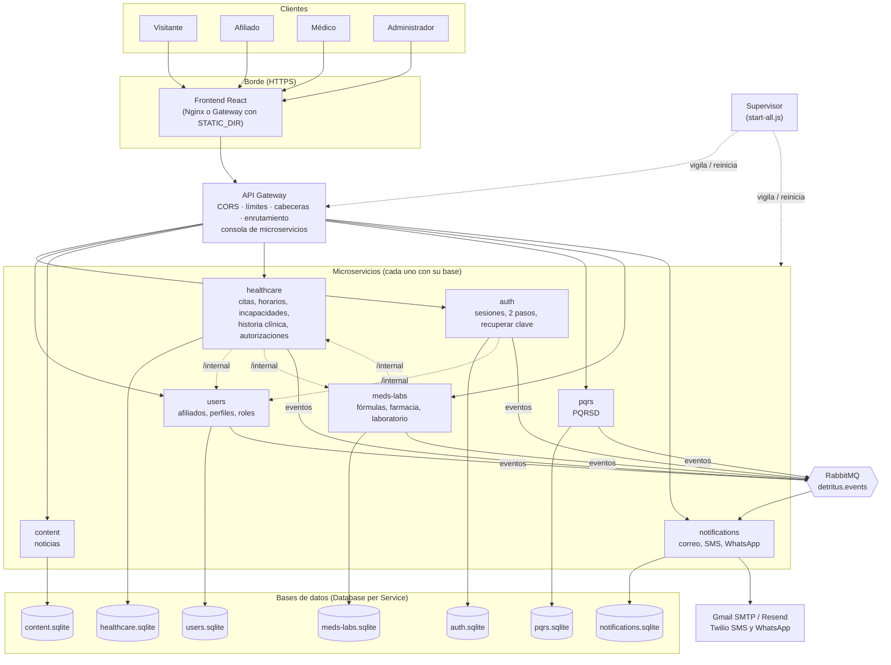

# 4. Arquitectura del sistema

## 4.1 Descripción jerárquica

El software **no es monolítico**: es un frontend SPA y un backend de **7 microservicios** independientes detrás de un **API Gateway**. Cada microservicio es un proceso Node.js con su propio puerto y su propia base de datos SQLite (*Database per Service*). Se comunican de tres formas:

1. **Navegador → API Gateway** (HTTP/HTTPS, `/api/<servicio>/...`).
2. **Servicio → servicio** de forma síncrona por rutas `/internal/*`, firmadas con un token de servicio de 60 s.
3. **Servicio → Notificaciones** de forma asíncrona por eventos en RabbitMQ (exchange `detritus.events`), con respaldo por HTTP si RabbitMQ no está.

Organización de carpetas (paquetes):

```
DetritusSaludEPS/
├── src/                      Frontend (React + Vite)
│   ├── components/           Navbar, Footer, LoginModal, Documents, ServiceStatusBanner…
│   ├── context/              AuthContext (sesión y perfil activo)
│   ├── lib/                  validators (compartidos con el backend), roles, captcha
│   ├── pages/                Home, Afiliados, Trámites, Atención, Nosotros, Portal, Legal
│   │   └── Portal/           Portales de afiliado, médico y administrador
│   └── services/api.js       Único cliente HTTP hacia el API Gateway
├── backend/
│   ├── src/
│   │   ├── gateway.js        API Gateway (puerto 4000)
│   │   ├── start-all.js      Supervisor: arranca, vigila y apaga/enciende microservicios
│   │   ├── *-service.js      Un archivo por microservicio
│   │   ├── service.js        Servidor HTTP común, lectura segura de JSON, errores
│   │   ├── internal.js       Llamadas entre servicios + cortacircuitos + caché
│   │   ├── broker.js         Bus de eventos (RabbitMQ / respaldo HTTP)
│   │   ├── database.js       Acceso a SQLite, migraciones, cifrado transparente
│   │   └── security/         Contraseñas, JWT, TOTP, cabeceras, límites, cifrado, auditoría
│   ├── data/schemas/*.sql    Un esquema por base de datos
│   └── test/                 Pruebas unitarias, integración, seguridad y resiliencia
├── nginx/default.conf        Proxy HTTPS (Docker)
├── deploy/Dockerfile         Imagen todo-en-uno para publicar
├── docker-compose.yml        Un contenedor por microservicio + RabbitMQ + Nginx
├── render.yaml               Despliegue en Render
└── docs/                     Esta documentación
```

## 4.2 Diagrama de módulos

Vista global (sin detalles técnicos internos). GitHub dibuja el diagrama automáticamente.



Versión en imagen: [img/arquitectura-modulos.png](img/arquitectura-modulos.png).

Líneas continuas: peticiones directas. Punteadas: llamadas internas con token de servicio. “eventos”: mensajes asíncronos.

## 4.3 Descripción individual de los módulos

| Módulo | Puerto | Responsabilidad | Depende de |
|---|---|---|---|
| **Frontend** (`src/`) | 5173 (dev) | Interfaz de visitantes, afiliados, médicos y administradores. El token de acceso vive solo en memoria. Muestra un aviso si algún microservicio está apagado. | API Gateway |
| **API Gateway** (`gateway.js`) | 4000 | Única puerta de entrada: CORS por lista blanca, cabeceras de seguridad, límite de peticiones, `X-Request-Id`, bloqueo de `/internal`, CAPTCHA en consultas públicas, `/api/health`, consola de microservicios (`/api/admin/services`) y, si se configura, sirve la página compilada. | Todos los microservicios (ninguno es obligatorio para que el gateway responda) |
| **Supervisor** (`start-all.js`) | — | Arranca los 7 servicios y el gateway; reinicia el que se caiga por error; apaga/enciende servicios por orden del administrador o desde la terminal. | — |
| **auth** | 4001 | Inicio de sesión, JWT de 15 min, refresh token en cookie HttpOnly con rotación, verificación en dos pasos (TOTP), bloqueo por intentos, recuperación de contraseña, sesiones abiertas. | users (validar credenciales), healthcare (datos del médico), notifications (eventos) |
| **users** | 4002 | Afiliados, beneficiarios, planes, registro, afiliación, perfil, roles (afiliado/médico/administrador), consulta pública de afiliación. Dueño de la identidad común `affiliate_id`. | healthcare (crear ficha de médico) |
| **content** | 4003 | Noticias de la página de inicio. | — |
| **notifications** | 4004 | Consume eventos y envía correo (SMTP/Resend), SMS y WhatsApp (Twilio); bandeja de notificaciones del usuario y del administrador. | users (datos de contacto) |
| **healthcare** | 4005 | Médicos, horarios, ausencias e incapacidades (con reasignación automática), citas sin cruces, atención, historia clínica cifrada, autorizaciones y su auditoría. | users (nombres), meds-labs (órdenes de laboratorio), notifications (eventos) |
| **pqrs** | 4006 | Radicación de PQRSD (con o sin cuenta), plazos legales en días hábiles, historial de estados, bandeja y respuesta del administrador. | users (opcional: asociar afiliado), notifications (eventos) |
| **meds-labs** | 4007 | Fórmulas médicas, despacho en farmacia, órdenes y resultados de laboratorio con documento imprimible; auditoría de accesos. | healthcare (validar cita y médico), users (nombres), notifications (eventos) |
| **RabbitMQ** | 5672 (interno) | Bus de eventos con cola durable `notifications.queue`. Opcional: sin él los eventos van por HTTP. | — |
| **Nginx** | 8080/8443 | Solo en Docker: HTTPS, cabeceras, sirve el frontend y reenvía `/api` al gateway. | API Gateway |

**Decisiones clave**

- **Identidad común sin llaves foráneas entre bases:** `affiliate_id` vive en users; los demás lo guardan como referencia lógica.
- **Validación del token sin llamar a auth:** cada servicio verifica el JWT con la llave compartida `AUTH_SECRET`. Por eso, si auth se cae, quien ya inició sesión sigue trabajando.
- **Eventos sin datos clínicos:** `broker.js` elimina diagnóstico, notas, resultados, contraseñas y códigos antes de publicar.
