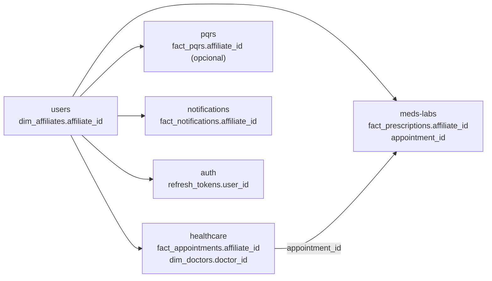

# 5. Diseño del modelo de datos

## 5.1 Modelo general: una base de datos por microservicio

Cada microservicio es **dueño exclusivo** de su base de datos SQLite (patrón *Database per Service*). Ningún servicio abre la base de otro: si necesita un dato ajeno lo pide por HTTP interno (`/internal/*`) o lo recibe en un evento. Así un servicio puede apagarse, cambiar su esquema o migrar de motor sin afectar a los demás.

| Base | Dueño | Qué guarda | Datos sensibles (cifrados AES-256-GCM) |
|---|---|---|---|
| `auth.sqlite` | auth | Intentos de ingreso, códigos de recuperación (hash), refresh tokens (hash), secretos TOTP | Secreto TOTP |
| `users.sqlite` | users | Afiliados, roles, planes, beneficiarios, autorización de datos | Dirección, ingresos, grupo SISBÉN |
| `content.sqlite` | content | Noticias | — |
| `notifications.sqlite` | notifications | Cada mensaje enviado por canal y su estado | — |
| `healthcare.sqlite` | healthcare | Médicos, horarios, ausencias, citas, autorizaciones, antecedentes y evoluciones clínicas | Historia clínica, antecedentes, diagnósticos |
| `pqrs.sqlite` | pqrs | Radicados PQRSD e historial de estados | — |
| `meds-labs.sqlite` | meds-labs | Fórmulas, despachos, órdenes y resultados de laboratorio | Indicaciones, resultados y observaciones |

**Convenciones**

- Prefijo `dim_` para tablas de catálogo/dimensión (médicos, planes, afiliados) y `fact_` para hechos o transacciones (citas, fórmulas, PQRS, notificaciones). Facilita llevar los datos a un tablero analítico.
- La identidad común es `affiliate_id` (texto). Vive en `users.dim_affiliates` y los demás la guardan como **referencia lógica**, sin llave foránea entre bases distintas.
- Fechas en texto ISO 8601 (`2026-11-02`, `2026-11-02T08:20:00.000Z`).
- Las contraseñas, códigos y tokens nunca se guardan en claro: solo su hash (scrypt o SHA-256).
- Los archivos están en `backend/data/db/` (se crean solos al arrancar) y sus esquemas en `backend/data/schemas/*.sql`.

## 5.2 Relaciones entre bases (referencias lógicas)

## 5.3 Tablas por base de datos

Generado a partir de `backend/data/schemas/*.sql`.

### auth-service · `auth.sqlite`

Base de datos de AUTH SERVICE (auth.sqlite) Seguridad del acceso: intentos de inicio de sesión (bloqueo por fuerza bruta) y códigos de recuperación de contraseña. Las credenciales las valida users-service.

**`login_attempts`**

| Columna | Tipo | Restricciones / nota |
|---|---|---|
| `attempt_id` | INTEGER | `PRIMARY KEY AUTOINCREMENT` |
| `document` | TEXT | `NOT NULL` |
| `success` | INTEGER | `NOT NULL CHECK (success IN (0, 1))` |
| `attempted_at` | TEXT | `NOT NULL` |

**`password_resets`**

| Columna | Tipo | Restricciones / nota |
|---|---|---|
| `reset_id` | TEXT | `PRIMARY KEY` |
| `user_id` | TEXT | `NOT NULL` |
| `document` | TEXT | `NOT NULL` |
| `code_hash` | TEXT | `NOT NULL` · el código de 6 dígitos se guarda con hash |
| `channels` | TEXT | `NOT NULL` · canales por los que se envió (email, sms, whatsapp) |
| `expires_at` | TEXT | `NOT NULL` |
| `attempts` | INTEGER | `NOT NULL DEFAULT 0` |
| `used_at` | TEXT |  |
| `created_at` | TEXT | `NOT NULL` |

**`refresh_tokens`**

| Columna | Tipo | Restricciones / nota |
|---|---|---|
| `token_hash` | TEXT | `PRIMARY KEY` |
| `family_id` | TEXT | `NOT NULL` |
| `user_id` | TEXT | `NOT NULL` |
| `role` | TEXT | `NOT NULL` |
| `mfa` | INTEGER | `NOT NULL DEFAULT 0` |
| `created_at` | TEXT | `NOT NULL` |
| `expires_at` | TEXT | `NOT NULL` |
| `revoked_at` | TEXT |  |
| `revoked_reason` | TEXT |  |
| `user_agent` | TEXT |  |

**`user_mfa`**

| Columna | Tipo | Restricciones / nota |
|---|---|---|
| `user_id` | TEXT | `PRIMARY KEY` |
| `secret` | TEXT |  |
| `pending_secret` | TEXT |  |
| `enabled_at` | TEXT |  |
| `last_step` | INTEGER | `NOT NULL DEFAULT -1` |
| `updated_at` | TEXT | `NOT NULL` |

### users-service · `users.sqlite`

Base de datos de USERS SERVICE (users.sqlite) Dueño de la identidad: personas, credenciales, perfiles de acceso, planes y beneficiarios.

**`dim_plans`**

| Columna | Tipo | Restricciones / nota |
|---|---|---|
| `plan_id` | INTEGER | `PRIMARY KEY AUTOINCREMENT` |
| `name` | TEXT | `NOT NULL UNIQUE` |
| `regime` | TEXT | `NOT NULL` |

**`dim_affiliates`**

| Columna | Tipo | Restricciones / nota |
|---|---|---|
| `affiliate_id` | TEXT | `PRIMARY KEY` |
| `name` | TEXT | `NOT NULL` |
| `document` | TEXT | `NOT NULL UNIQUE CHECK (length(document) BETWEEN 5 AND 12)` |
| `password` | TEXT | `NOT NULL` · hash PBKDF2 (sal:hash), nunca la contraseña en texto |
| `email` | TEXT |  |
| `phone` | TEXT |  |
| `whatsapp_opt_in` | INTEGER | `NOT NULL DEFAULT 0` |
| `role` | TEXT | `NOT NULL DEFAULT 'affiliate'` |
| `status` | TEXT | `NOT NULL DEFAULT 'active'` |
| `plan_id` | INTEGER | `NOT NULL` |
| `document_type` | TEXT | `DEFAULT 'CC'` |
| `first_name` | TEXT, | `second_name TEXT, first_surname TEXT, second_surname TEXT` |
| `birth_date` | TEXT, | `sex TEXT` |
| `department` | TEXT, | `city TEXT, zone TEXT, address TEXT, neighborhood TEXT, landline TEXT` |
| `affiliate_type` | TEXT, | `employer_name TEXT, employer_nit TEXT, base_income TEXT` |
| `economic_activity` | TEXT, | `pension_fund TEXT, sisben_group TEXT, previous_eps TEXT` |
| `primary_ips` | TEXT, | `filing_number TEXT, effective_date TEXT` |
| `password_changed_at` | TEXT |  |
| `created_at` | TEXT | `NOT NULL DEFAULT CURRENT_TIMESTAMP` |
| *(tabla)* | | `FOREIGN KEY (plan_id) REFERENCES dim_plans(plan_id)` |

**`user_roles`**

| Columna | Tipo | Restricciones / nota |
|---|---|---|
| `user_id` | TEXT | `NOT NULL` |
| `role` | TEXT | `NOT NULL CHECK (role IN ('affiliate', 'doctor', 'administrator'))` |
| `created_at` | TEXT | `NOT NULL DEFAULT CURRENT_TIMESTAMP` |
| *(tabla)* | | `PRIMARY KEY (user_id, role)` |
| *(tabla)* | | `FOREIGN KEY (user_id) REFERENCES dim_affiliates(affiliate_id)` |

**`dim_beneficiaries`**

| Columna | Tipo | Restricciones / nota |
|---|---|---|
| `beneficiary_id` | INTEGER | `PRIMARY KEY AUTOINCREMENT` |
| `affiliate_id` | TEXT | `NOT NULL` |
| `document_type` | TEXT | `NOT NULL` |
| `document` | TEXT | `NOT NULL` |
| `name` | TEXT | `NOT NULL` |
| `relationship` | TEXT | `NOT NULL` |
| `birth_date` | TEXT | `NOT NULL` |
| `sex` | TEXT |  |
| `created_at` | TEXT | `NOT NULL DEFAULT CURRENT_TIMESTAMP` |
| *(tabla)* | | `UNIQUE (document_type, document)` |
| *(tabla)* | | `FOREIGN KEY (affiliate_id) REFERENCES dim_affiliates(affiliate_id)` |

### content-service · `content.sqlite`

Base de datos de CONTENT SERVICE (content.sqlite) Noticias y campañas que se publican en la página de inicio.

**`content_items`**

| Columna | Tipo | Restricciones / nota |
|---|---|---|
| `content_id` | INTEGER | `PRIMARY KEY AUTOINCREMENT` |
| `title` | TEXT | `NOT NULL` |
| `body` | TEXT | `NOT NULL` |
| `category` | TEXT | `NOT NULL` |
| `image` | TEXT |  |
| `published_at` | TEXT | `NOT NULL DEFAULT CURRENT_TIMESTAMP` |

### notifications-service · `notifications.sqlite`

Base de datos de NOTIFICATIONS SERVICE (notifications.sqlite) Bandeja de salida: una fila por cada mensaje enviado por correo, SMS o WhatsApp.

**`fact_notifications`**

| Columna | Tipo | Restricciones / nota |
|---|---|---|
| `notification_id` | TEXT | `PRIMARY KEY` |
| `event_id` | TEXT | `NOT NULL` · agrupa los mensajes de un mismo evento |
| `affiliate_id` | TEXT | referencia lógica a users-service (sin FK: otra base) |
| `event_type` | TEXT | `NOT NULL` |
| `channel` | TEXT | `NOT NULL CHECK (channel IN ('email', 'sms', 'whatsapp'))` |
| `recipient` | TEXT |  |
| `subject` | TEXT |  |
| `body` | TEXT | `NOT NULL` |
| `status` | TEXT | `NOT NULL CHECK (status IN ('queued', 'sent', 'simulated', 'failed', 'skipped'))` |
| `provider` | TEXT |  |
| `error` | TEXT |  |
| `reference` | TEXT | radicado, número de cita, fórmula… |
| `created_at` | TEXT | `NOT NULL` |
| `sent_at` | TEXT |  |

### healthcare-service · `healthcare.sqlite`

Base de datos de HEALTHCARE SERVICE (healthcare.sqlite) Médicos, horarios, ausencias (incapacidades), citas, autorizaciones e historia clínica.

**`dim_services`**

| Columna | Tipo | Restricciones / nota |
|---|---|---|
| `service_id` | INTEGER | `PRIMARY KEY AUTOINCREMENT` |
| `name` | TEXT | `NOT NULL UNIQUE` |
| `category` | TEXT | `NOT NULL` |

**`dim_dates`**

| Columna | Tipo | Restricciones / nota |
|---|---|---|
| `date_key` | TEXT | `PRIMARY KEY` |
| `date_value` | TEXT | `NOT NULL UNIQUE` |
| `year` | INTEGER | `NOT NULL` |
| `month` | INTEGER | `NOT NULL` |
| `day` | INTEGER | `NOT NULL` |

**`dim_doctors`**

| Columna | Tipo | Restricciones / nota |
|---|---|---|
| `doctor_id` | TEXT | `PRIMARY KEY` |
| `specialty` | TEXT | `NOT NULL` |
| `license` | TEXT |  |
| `site` | TEXT |  |
| `slot_minutes` | INTEGER | `NOT NULL DEFAULT 20 CHECK (slot_minutes BETWEEN 10 AND 120)` |
| `active` | INTEGER | `NOT NULL DEFAULT 1` |

**`doctor_schedules`**

| Columna | Tipo | Restricciones / nota |
|---|---|---|
| `schedule_id` | INTEGER | `PRIMARY KEY AUTOINCREMENT` |
| `doctor_id` | TEXT | `NOT NULL` |
| `weekday` | INTEGER | `NOT NULL CHECK (weekday BETWEEN 0 AND 6)` |
| `start_time` | TEXT | `NOT NULL` |
| `end_time` | TEXT | `NOT NULL` |
| *(tabla)* | | `UNIQUE (doctor_id, weekday, start_time)` |
| *(tabla)* | | `FOREIGN KEY (doctor_id) REFERENCES dim_doctors(doctor_id)` |

**`doctor_absences`**

| Columna | Tipo | Restricciones / nota |
|---|---|---|
| `absence_id` | TEXT | `PRIMARY KEY` |
| `doctor_id` | TEXT | `NOT NULL` |
| `type` | TEXT | `NOT NULL CHECK (type IN ('incapacidad', 'vacaciones', 'licencia', 'calamidad', 'capacitacion'))` |
| `start_date` | TEXT | `NOT NULL` |
| `end_date` | TEXT | `NOT NULL` |
| `notes` | TEXT |  |
| `created_by` | TEXT | `NOT NULL` |
| `created_at` | TEXT | `NOT NULL` |
| `cancelled_at` | TEXT |  |
| *(tabla)* | | `CHECK (end_date >= start_date)` |
| *(tabla)* | | `FOREIGN KEY (doctor_id) REFERENCES dim_doctors(doctor_id)` |

**`fact_appointments`**

| Columna | Tipo | Restricciones / nota |
|---|---|---|
| `appointment_id` | TEXT | `PRIMARY KEY` |
| `affiliate_id` | TEXT | `NOT NULL` · referencia lógica a users-service |
| `service_id` | INTEGER |  |
| `date_key` | TEXT |  |
| `specialty` | TEXT | `NOT NULL` |
| `appointment_date` | TEXT | `NOT NULL` |
| `appointment_time` | TEXT |  |
| `duration_minutes` | INTEGER | `NOT NULL DEFAULT 20` |
| `status` | TEXT | `NOT NULL CHECK (status IN ('requested', 'confirmed', 'completed', 'no_show', 'cancelled', 'reschedule_required'))` |
| `doctor_id` | TEXT |  |
| `modality` | TEXT |  |
| `site` | TEXT |  |
| `exam_code` | TEXT |  |
| `lab_order_number` | TEXT |  |
| `reason` | TEXT |  |
| `diagnosis` | TEXT |  |
| `clinical_notes` | TEXT |  |
| `change_note` | TEXT | explica reasignaciones / reprogramaciones al paciente |
| `original_doctor_id` | TEXT |  |
| `created_at` | TEXT | `NOT NULL DEFAULT CURRENT_TIMESTAMP` |
| `updated_at` | TEXT |  |
| *(tabla)* | | `FOREIGN KEY (service_id) REFERENCES dim_services(service_id)` |
| *(tabla)* | | `FOREIGN KEY (date_key) REFERENCES dim_dates(date_key)` |
| *(tabla)* | | `FOREIGN KEY (doctor_id) REFERENCES dim_doctors(doctor_id)` |

**`fact_authorizations`**

| Columna | Tipo | Restricciones / nota |
|---|---|---|
| `authorization_id` | TEXT | `PRIMARY KEY` |
| `affiliate_id` | TEXT | `NOT NULL` |
| `service_id` | INTEGER |  |
| `status` | TEXT | `NOT NULL CHECK (status IN ('requested', 'approved', 'denied'))` |
| `service_code` | TEXT |  |
| `service_name` | TEXT |  |
| `category` | TEXT |  |
| `ordered_by` | TEXT |  |
| `order_reference` | TEXT |  |
| `reason` | TEXT |  |
| `priority` | TEXT |  |
| `auth_number` | TEXT |  |
| `provider` | TEXT |  |
| `valid_until` | TEXT |  |
| `decided_by` | TEXT |  |
| `decided_at` | TEXT |  |
| `decision_notes` | TEXT |  |
| `appointment_id` | TEXT |  |
| `created_at` | TEXT | `NOT NULL DEFAULT CURRENT_TIMESTAMP` |
| *(tabla)* | | `FOREIGN KEY (service_id) REFERENCES dim_services(service_id)` |
| *(tabla)* | | `FOREIGN KEY (appointment_id) REFERENCES fact_appointments(appointment_id)` |

**`clinical_backgrounds`**

| Columna | Tipo | Restricciones / nota |
|---|---|---|
| `patient_id` | TEXT | `PRIMARY KEY` |
| `blood_type` | TEXT | `CHECK (blood_type IS NULL OR blood_type IN ('O+', 'O-', 'A+', 'A-', 'B+', 'B-', 'AB+', 'AB-'))` |
| `allergies` | TEXT |  |
| `personal_history` | TEXT |  |
| `family_history` | TEXT |  |
| `surgical_history` | TEXT |  |
| `current_medications` | TEXT |  |
| `habits` | TEXT |  |
| `updated_by` | TEXT |  |
| `updated_at` | TEXT |  |

**`clinical_encounters`**

| Columna | Tipo | Restricciones / nota |
|---|---|---|
| `encounter_id` | TEXT | `PRIMARY KEY` |
| `appointment_id` | TEXT | `NOT NULL UNIQUE` |
| `patient_id` | TEXT | `NOT NULL` |
| `doctor_id` | TEXT | `NOT NULL` |
| `doctor_name` | TEXT | `NOT NULL` |
| `specialty` | TEXT | `NOT NULL` |
| `encounter_date` | TEXT | `NOT NULL` |
| `chief_complaint` | TEXT | motivo de consulta |
| `current_illness` | TEXT | enfermedad actual |
| `blood_pressure` | TEXT |  |
| `heart_rate` | INTEGER |  |
| `respiratory_rate` | INTEGER |  |
| `temperature` | REAL |  |
| `weight_kg` | REAL |  |
| `height_cm` | REAL |  |
| `oxygen_saturation` | INTEGER |  |
| `physical_exam` | TEXT |  |
| `diagnosis` | TEXT | `NOT NULL` |
| `diagnosis_code` | TEXT | CIE-10 |
| `plan` | TEXT |  |
| `created_at` | TEXT | `NOT NULL` |
| *(tabla)* | | `FOREIGN KEY (appointment_id) REFERENCES fact_appointments(appointment_id)` |

### pqrs-service · `pqrs.sqlite`

Base de datos de PQRS SERVICE (pqrs.sqlite) Peticiones, quejas, reclamos, sugerencias y denuncias con su historial de estados.

**`fact_pqrs`**

| Columna | Tipo | Restricciones / nota |
|---|---|---|
| `pqrs_id` | TEXT | `PRIMARY KEY` · radicado PQRS-AAAA-NNNNNN |
| `affiliate_id` | TEXT | referencia lógica a users-service (NULL si no es afiliado) |
| `type` | TEXT | `NOT NULL CHECK (type IN ('Petición', 'Queja', 'Reclamo', 'Sugerencia', 'Denuncia'))` |
| `subject` | TEXT | `NOT NULL` |
| `description` | TEXT | `NOT NULL` |
| `requester_name` | TEXT | `NOT NULL` |
| `document_type` | TEXT | `NOT NULL DEFAULT 'CC'` |
| `document` | TEXT | `NOT NULL` |
| `email` | TEXT | `NOT NULL` |
| `phone` | TEXT | `NOT NULL` |
| `status` | TEXT | `NOT NULL CHECK (status IN ('received', 'in_review', 'answered', 'closed'))` |
| `response` | TEXT |  |
| `responded_by` | TEXT |  |
| `responded_at` | TEXT |  |
| `due_date` | TEXT | `NOT NULL` · fecha límite legal de respuesta (días hábiles) |
| `created_at` | TEXT | `NOT NULL` |
| `updated_at` | TEXT |  |

**`pqrs_status_history`**

| Columna | Tipo | Restricciones / nota |
|---|---|---|
| `history_id` | INTEGER | `PRIMARY KEY AUTOINCREMENT` |
| `pqrs_id` | TEXT | `NOT NULL` |
| `status` | TEXT | `NOT NULL` |
| `note` | TEXT |  |
| `changed_by` | TEXT |  |
| `changed_at` | TEXT | `NOT NULL` |
| *(tabla)* | | `FOREIGN KEY (pqrs_id) REFERENCES fact_pqrs(pqrs_id)` |

### meds-labs-service · `meds-labs.sqlite`

Base de datos de MEDS-LABS SERVICE (meds-labs.sqlite) Fórmulas médicas, entregas de farmacia y órdenes / documentos de laboratorio.

**`fact_prescriptions`**

| Columna | Tipo | Restricciones / nota |
|---|---|---|
| `prescription_id` | TEXT | `PRIMARY KEY` |
| `affiliate_id` | TEXT | `NOT NULL` · referencia lógica a users-service |
| `prescription_number` | TEXT | `NOT NULL UNIQUE` |
| `formula_number` | TEXT | `NOT NULL` · una fórmula agrupa uno o varios medicamentos |
| `medication_name` | TEXT | `NOT NULL` |
| `dosage` | TEXT | `NOT NULL` |
| `quantity` | INTEGER | `NOT NULL CHECK (quantity BETWEEN 1 AND 360)` |
| `status` | TEXT | `NOT NULL CHECK (status IN ('pending', 'available', 'delivered', 'cancelled'))` |
| `issued_at` | TEXT | `NOT NULL` |
| `delivery_point` | TEXT |  |
| `doctor_id` | TEXT |  |
| `doctor_name` | TEXT |  |
| `appointment_id` | TEXT | referencia lógica a healthcare-service |
| `instructions` | TEXT |  |
| `valid_until` | TEXT |  |
| `updated_at` | TEXT |  |

**`fact_medication_dispensations`**

| Columna | Tipo | Restricciones / nota |
|---|---|---|
| `dispensation_id` | TEXT | `PRIMARY KEY` |
| `prescription_id` | TEXT | `NOT NULL` |
| `affiliate_id` | TEXT | `NOT NULL` |
| `status` | TEXT | `NOT NULL` |
| `dispensed_at` | TEXT |  |
| `delivery_point` | TEXT |  |
| *(tabla)* | | `FOREIGN KEY (prescription_id) REFERENCES fact_prescriptions(prescription_id)` |

**`fact_lab_results`**

| Columna | Tipo | Restricciones / nota |
|---|---|---|
| `lab_result_id` | TEXT | `PRIMARY KEY` |
| `affiliate_id` | TEXT | `NOT NULL` |
| `order_number` | TEXT | `NOT NULL UNIQUE` |
| `test_name` | TEXT | `NOT NULL` |
| `exam_code` | TEXT |  |
| `result` | TEXT |  |
| `status` | TEXT | `NOT NULL CHECK (status IN ('scheduled', 'processing', 'available', 'cancelled', 'pending'))` |
| `result_date` | TEXT |  |
| `appointment_id` | TEXT |  |
| `appointment_date` | TEXT | copia de la cita para mostrar el documento sin consultar otra base |
| `appointment_time` | TEXT |  |
| `site` | TEXT |  |
| `sample_type` | TEXT |  |
| `sample_taken_at` | TEXT |  |
| `sample_taken_by` | TEXT |  |
| `validated_by` | TEXT |  |
| `validated_at` | TEXT |  |
| `observations` | TEXT |  |

**`fact_lab_result_items`**

| Columna | Tipo | Restricciones / nota |
|---|---|---|
| `item_id` | INTEGER | `PRIMARY KEY AUTOINCREMENT` |
| `lab_result_id` | TEXT | `NOT NULL` |
| `position` | INTEGER | `NOT NULL` |
| `parameter` | TEXT | `NOT NULL` |
| `value` | TEXT |  |
| `unit` | TEXT |  |
| `reference_range` | TEXT |  |
| `flag` | TEXT |  |
| *(tabla)* | | `UNIQUE (lab_result_id, position)` |
| *(tabla)* | | `FOREIGN KEY (lab_result_id) REFERENCES fact_lab_results(lab_result_id)` |

