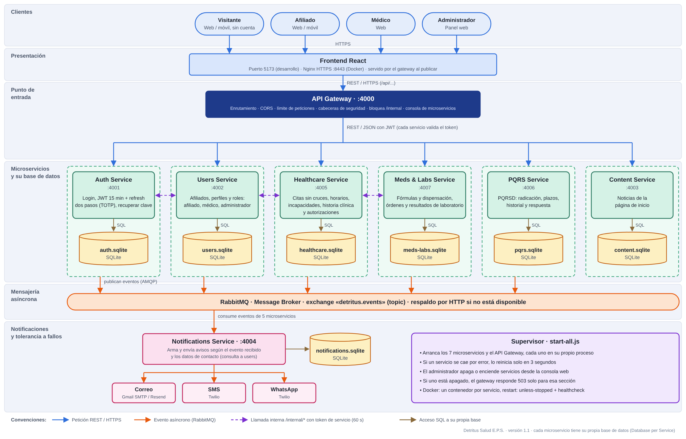

# 10. Diagrama de arquitectura de microservicios

Diagrama por capas del sistema tal como está implementado en el código (versión 1.1): clientes, presentación, punto de entrada, microservicios con su base de datos, mensajería asíncrona, y notificaciones y tolerancia a fallos.

Versión vectorial para ampliar sin perder calidad: [img/diagrama-arquitectura-microservicios.svg](img/diagrama-arquitectura-microservicios.svg).

## Lectura del diagrama por capas

| Capa | Componentes | Comunicación |
|---|---|---|
| Clientes | Visitante (sin cuenta), Afiliado, Médico, Administrador | HTTPS |
| Presentación | Frontend React: puerto 5173 en desarrollo, Nginx HTTPS :8443 con Docker, o servido por el gateway al publicar | REST / HTTPS hacia `/api/...` |
| Punto de entrada | API Gateway :4000: enrutamiento, CORS, límite de peticiones, cabeceras de seguridad, bloqueo de `/internal`, consola de microservicios | REST / JSON con JWT; cada servicio valida el token por su cuenta |
| Microservicios y su base de datos | Auth :4001, Users :4002, Healthcare :4005, Meds & Labs :4007, PQRS :4006, Content :4003; cada uno con su propio archivo SQLite | SQL solo contra su propia base (*Database per Service*); llamadas internas `/internal/*` con token de servicio de 60 s |
| Mensajería asíncrona | RabbitMQ, exchange `detritus.events` (topic), con respaldo por HTTP | Auth, Users, Healthcare, Meds & Labs y PQRS publican eventos (AMQP) |
| Notificaciones y tolerancia a fallos | Notifications :4004 con `notifications.sqlite`; correo (Gmail SMTP / Resend), SMS y WhatsApp (Twilio). Supervisor `start-all.js` | Notifications consume los eventos y consulta los datos de contacto en Users. El supervisor arranca, reinicia y apaga/enciende los servicios |

## Microservicios

| Servicio | Puerto | Base de datos | Responsabilidad |
|---|---|---|---|
| Auth | 4001 | `auth.sqlite` | Login, JWT de 15 min + refresh token, dos pasos (TOTP), recuperar contraseña |
| Users | 4002 | `users.sqlite` | Afiliados, perfiles y roles (afiliado, médico, administrador), registro y afiliación |
| Content | 4003 | `content.sqlite` | Noticias de la página de inicio |
| Notifications | 4004 | `notifications.sqlite` | Avisos por correo, SMS y WhatsApp; bandeja de notificaciones |
| Healthcare | 4005 | `healthcare.sqlite` | Citas sin cruces, horarios, incapacidades, historia clínica y autorizaciones |
| PQRS | 4006 | `pqrs.sqlite` | PQRSD: radicación, plazos legales, historial y respuesta |
| Meds & Labs | 4007 | `meds-labs.sqlite` | Fórmulas y dispensación, órdenes y resultados de laboratorio |

## Cambios frente al diagrama de diseño anterior

- "Appointment Service" pasó a llamarse **Healthcare Service** (:4005) y quedó a cargo también de las **autorizaciones**, porque estas nacen de la atención de la cita.
- "Trámites Service" quedó como **PQRS Service** (:4006).
- Se agregó **Content Service** (:4003) para las noticias.
- Las bases son **SQLite**, una por servicio. Migrar a PostgreSQL con un usuario por servicio es el paso recomendado para producción.
- El exchange se llama `detritus.events` y tiene respaldo por HTTP.
- Se retiraron los sistemas externos (ADRES, MinSalud, IPS): están fuera del alcance de la versión académica, que usa datos ficticios.
- Se agregó el **Supervisor** (tolerancia a fallos) y las llamadas internas entre servicios.

El diagrama de módulos generado desde el código está en [04-arquitectura.md](04-arquitectura.md).
